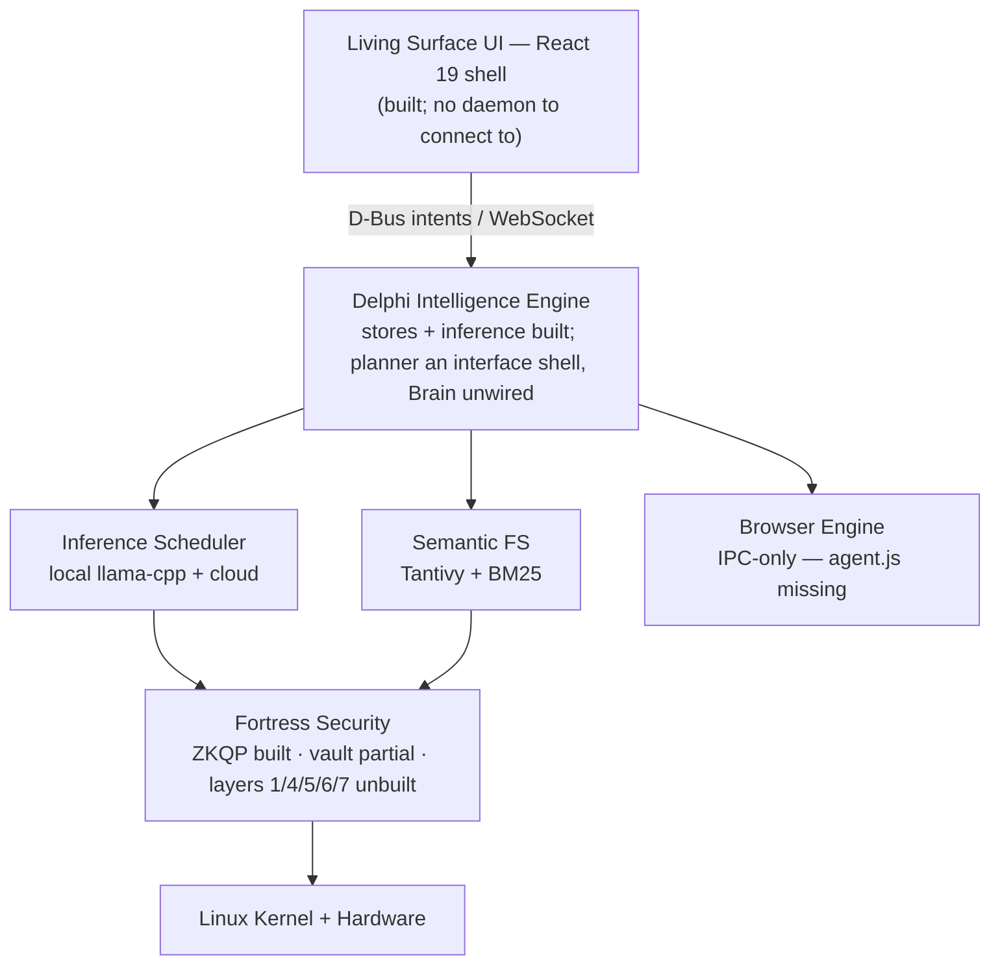

# Delphi OS

**Pre-product research codebase (v0.4).** Delphi is an in-progress attempt to build an
*agentic operating system* — one where a persistent, multi-agent intelligence engine
operates the user's existing software tools on their behalf, with user sovereignty and
mathematically-enforced privacy as foundational commitments.

This repository is the **substrate**: a Rust workspace plus a React shell implementing the
subsystems an agentic OS depends on. It is **not yet a runnable system** — read the honest
status below before forming expectations.

> The expansive vision (kernel-level access, "any task through natural language") is the
> North Star, recorded in [`CLAUDE.md`](CLAUDE.md) and [`DELPHI_COMPLETE_SPEC.md`](DELPHI_COMPLETE_SPEC.md).
> This README states what **exists today**, which is a long way from that vision and is
> marked as such. Honest status is a feature here, not an afterthought.

## Project status (honest record)

**Stage: pre-product.** There is **no executable target in the workspace** — no `main.rs`,
no `[[bin]]` in any `Cargo.toml`. Delphi builds as a set of libraries and runs as a **test
suite**; it cannot be booted, demoed, or launched as an application today. The single
largest gap between this codebase and its vision is that **nothing runs end-to-end yet** —
bringing up a runnable daemon is the next major arc, tracked separately from this substrate.

**Verified (CI-gated, [`.github/workflows/ci.yml`](.github/workflows/ci.yml)):**

- **1891** Rust tests pass — `cargo test --workspace`, 0 failed
- **94** TypeScript tests pass — `pnpm test` in `shell/` (11 files)
- `cargo clippy --workspace --all-targets -- -D warnings` clean
- `cargo audit` + `cargo deny check` gated (advisory acceptances documented in [`deny.toml`](deny.toml))

### What is real vs. scaffolded vs. stub

Status is stated from what the **code actually does**, not from interface shape. *Built* =
working and tested **as a component**; *stub* = the interface exists but the body is a
placeholder; *IPC-only* / *scaffold-only* sit between. Two caveats apply to every ✅ row:
**nothing here runs in a live system** (there is no daemon — see above), and several built
components are also **unwired** (no production consumer), flagged inline. "Built" means
"works when called by a test," not "in production use."

| Subsystem | Status | Honest note |
|---|---|---|
| **ZKQP** PII egress sanitizer (`fortress/zkqp`) | ✅ Built, tested, adversarially swept | Strongest subsystem — Unicode-complete detectors + span-based sanitizer; 3 Codex rounds + property tests |
| **Fortress** vault / permissions / audit | ✅ Built (partial), **unwired** | AES-256-GCM vault, Argon2id KDF, 4-tier permission engine, SHA-256 audit chain. **Unwired** — the vault *and* the permission engine have no production consumer (`services/` runs its own independent auth model); nothing is in live use |
| **semantic-fs** index + search | ✅ Built | Tantivy full-text + BM25. Known correctness gap in incremental re-index (duplicate docs on re-save) |
| **die-inference** local + cloud | ✅ Built | llama-cpp-2 local generation + Anthropic cloud client behind a ZKQP-enforced egress gate |
| **die-orchestrator** stores | ✅ Built | Knowledge / timeline / goal / conversation SQLite stores (hardened SQLite policy) |
| **die-orchestrator** planner / brain | ⚠️ Interface shell | `Planner::plan()` logs then returns an error on every call ("inference backends not yet available"); Brain unwired |
| **die-browser** | ⚠️ IPC-only | Rust subprocess engine built + tested, but the Playwright `agent.js` it drives **does not exist in-repo** |
| **die-voice** STT / TTS | 🔴 Stub | Returns placeholder text / silence; no whisper-rs / Piper integration |
| **die-builder** | 🔴 Scaffold-only | Template file-copy works; `{{var}}` substitution, build/generate/test states, minijinja, post-scaffold exec all unimplemented |
| **EncryptionService** (at-rest) | 🔴 Stub | `encrypt` / `decrypt` return an error on every call |
| **LocalEmbedder** | 🔴 Stub | Returns empty vectors with `Unavailable` fidelity |
| **compositor** (Wayland / Smithay) | 📚 Library | Builds as a library; not a running compositor |
| **shell** (React 19) | ✅ Built (UI) | 94 tests; speaks a WebSocket protocol to a bridge that has no daemon to start it |
| **delphi-hardening** | ✅ Built | Shared primitives (canonical hashing, safe-open, SQLite policy) extracted from adversarial-review history |

### Fortress seven-layer security (per spec)

| Layer | Status |
|---|---|
| 3 — Zero-Knowledge Query Protocol (ZKQP) | ✅ Built |
| 2 — Disk / at-rest encryption | ⚠️ Partial (AES-256-GCM vault; hidden volumes + at-rest service not built) |
| 1 — Hardware root of trust (TPM) | 🔴 Not started |
| 4 — Fully Homomorphic Encryption | 🔴 Not started |
| 5 — Federated behavioral sync | 🔴 Not started |
| 6 — zk-SNARK audit proofs | 🔴 Not started (the SHA-256 audit chain is a precursor) |
| 7 — Post-quantum crypto (Kyber / Dilithium) | 🔴 Not started |

## Architecture (intended)

The diagram is the **intended** six-layer design; per the status table above, most layers
are partial or unbuilt.



**Cargo dependency DAG:** `fortress` is the foundation (with `delphi-hardening` as a leaf
below it); `die-inference`, `die-learning`, and `semantic-fs` depend on `fortress`;
`die-orchestrator` composes them; `delphi-services` and `shell-bridge` sit on top. See
[`CLAUDE.md`](CLAUDE.md) §4 for the authoritative DAG.

## Operating model (intended): highest-fidelity-wins

Delphi is designed to operate the user's existing applications through a tiered-fidelity
hierarchy (Iron Law #13), always preferring the highest-fidelity interface available:

1. **SSI manifest** — an app's declared semantic interface (highest fidelity)
2. **Accessibility tree** — AT-SPI / UI Automation introspection when no manifest exists
3. **Screen-and-click** — computer-vision fallback (universal, lowest fidelity)

This is an architectural commitment. The SSI SDK (`ssi/sdk-rust`) exists; manifest
auto-generation and the higher tiers are forward work.

## Building from a clean clone

There is nothing to *run* yet — the build produces libraries and a test suite.

```bash
git clone <repo-url> delphi && cd delphi

# Rust workspace (the compositor needs Linux Wayland libs):
cargo test --workspace                                  # 1891 tests
cargo clippy --workspace --all-targets -- -D warnings

# On macOS / Windows (no Wayland) — exclude the compositor:
cargo test --workspace --exclude compositor

# Shell UI:
cd shell && pnpm install && pnpm test && pnpm build      # 94 tests
```

**Prerequisites:** Rust 1.85+ (edition 2024), Node 20+ with pnpm, Python 3.12+ (ML
pipelines). The full compositor build needs Linux `libwayland-dev libudev-dev libinput-dev
libxkbcommon-dev`.

There is **no `cargo run`** — no binary exists.

## How this codebase is built

Delphi is developed under a verifiable-record discipline ([`CLAUDE.md`](CLAUDE.md) §13):
every claim is grounded in code or command output, security-critical changes get a cold
adversarial review (an external Codex model, run by the operator), and each fix ships a
regression test proven to fail against the pre-fix code. Recurring defect classes are
catalogued in [`docs/DEFECT_CLASSES.md`](docs/DEFECT_CLASSES.md) and foreclosed by shared
primitives in `delphi-hardening`.

## Documentation

- [`CLAUDE.md`](CLAUDE.md) — project law: architecture, coding standards, the Iron Laws, the
  dependency DAG, the capability + Fortress trackers
- [`DELPHI_COMPLETE_SPEC.md`](DELPHI_COMPLETE_SPEC.md) — authoritative specification (the North Star)
- [`PROGRESS.md`](PROGRESS.md) — current phase / task / status breadcrumb
- [`docs/DEFECT_CLASSES.md`](docs/DEFECT_CLASSES.md) — defect-class corpus + foreclosing primitives

## License

MIT
